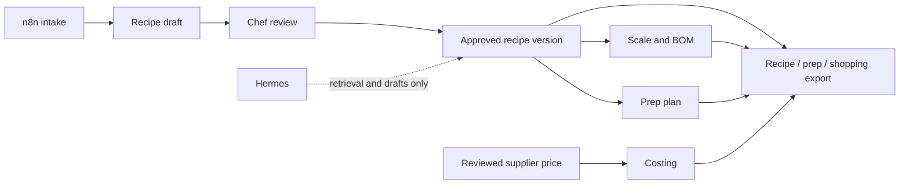

# CABIJ Kitchen V1 build sequence

## Product promise

One reviewed recipe truth produces the same scale, bill of materials, prep board, price evidence, and kitchen export for one client kitchen.

## Ownership map

## Build order

1. Apply and test `supabase/017_v1_recipe_truth.sql` in a disposable staging project. Prove tenant isolation with allow and deny cases before importing any client recipes.
2. Import a single kitchen's recipes into `draft` versions. Preserve `client_id`, `recipe_ref_id`, `canonical_id`, `clean_name`, and `canonical_name`.
3. Build the review and publish action. Publishing must create an approved immutable version; it must never overwrite a prior approved version.
4. Switch the scaler and BOM to read approved versions only. Add fixtures for mass, volume, count, yield loss, sub-recipes, and missing price evidence.
5. Connect reviewed invoice rows to `ingredient_price_evidence_v1`; show `PRICE REQUIRED` if any ingredient lacks a trusted price.
6. Generate prep tasks from pinned recipe versions and approved prep profiles. Keep AI output in review until a chef accepts it.
7. Add one export snapshot containing recipe-version IDs, price dates, quantities, and warnings. Render PDF and CSV from that immutable snapshot.
8. Pilot with one kitchen for two production cycles. Compare planned purchasing and prep against actual waste before offering waste-control reporting.

## Reused sources

| Source | V1 role |
| --- | --- |
| `Cabij_app_project/app` | Primary chef-facing web app and offline UX foundation. |
| `cabij_n8n_workflow` WF1/WF2/WF3 | Intake, reviewed chef enrichment, and orchestration templates. |
| `cabij_chef_database` | Source evidence and reusable operational knowledge. |
| `AI KITCHEN` | Export layout and event-production document patterns. |
| `cabij-os-hermes` | Assistant retrieval and reviewed calculation references; not recipe truth. |

## Explicit exclusions

- No credentials, n8n SQLite databases, user sessions, Google Drive links, or client data are copied into this repository.
- Legacy calculator constants and heuristic prep times are not treated as production facts.
- Hermes cannot publish recipes, prices, or client exports.
